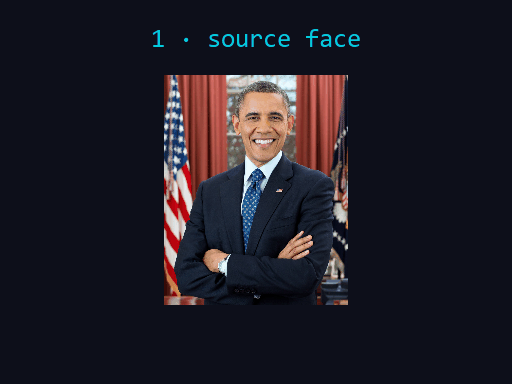

<p align="center">
  
</p>

<h1 align="center">PixelMorph</h1>

<p align="center"><b>Real-time face swap for your webcam, streamed to a virtual camera that works in every app.</b></p>

```bash
git clone https://github.com/GUURUUU/PixelMorph.git && cd PixelMorph && pip install -r requirements.txt && python scripts/download_models.py && python pixelmorph.py
```

---

**What you get:** load a face → press START → your webcam feed is swapped live and pushed to **OBS Virtual Camera** (or the registered *PixelMorph* filter), so WhatsApp, Zoom, Chrome, Windows Camera — anything that has a camera picker — shows the swap. Snapshots, recording, and an Android-phone-as-webcam bridge included.

## Features

- 🎥 **Live webcam swap** — SCRFD detection + ArcFace embedding + inswapper/hyperswap models, pixel-boost up to 512×512 per face, blends weights, color matching
- 📡 **Virtual camera in every app** — auto-detects the best backend (OBS → UnityCapture → DShow); *real* cameras are auto-picked over virtual ones for the input
- 🎛️ **Holographic control deck** — threshold / weight / resize sliders, pixel-boost selector, frame skip, image filters (CLAHE, sharpen, white balance)
- 💾 **Snapshot & REC** — still frames or full recordings of the swap output, one click
- 📱 **BestCam bridge** — GPL-2.0 Media Foundation virtual camera (Windows Camera / Microsoft-Foundation apps) + Android phone camera over MJPEG
- ⚙️ **Standalone face math** — no FaceFusion dependency, all helpers vendored in `app/ffcompat.py` (golden-tested against upstream)

## Quick start

1. **Python 3.10+** on Windows (the UI is a native PyQt6 app):
   ```bash
   pip install -r requirements.txt
   ```
2. **Models** (auto-resolves; or point `models/` to a folder that has the four `.onnx` files):
   ```bash
   python scripts/download_models.py         # downloads to ./models
   # or: set PIXELMORPH_MODELS=/path/to/your/models
   ```
3. **Virtual camera driver** — install **[OBS Studio](https://obsproject.com)** (registers OBS Virtual Camera), *or* the trick-less DirectShow filter:
   ```bash
   UnityCapture\Install.bat                  # registers "PixelMorph DirectShow filter" (MIT, schellingb/UnityCapture)
   ```
4. **Run:**
   ```bash
   python pixelmorph.py        # or double-click pixelmorph.cmd
   ```

**In the app:** load a source face (photo of a person) → **START** → pick **OBS Virtual Camera** in any app's camera list.

#### WhatsApp / Chrome (Media Foundation-only apps)
OBS-EVC covers most apps; MF-locked apps need the kernel path — either [e2eSoft VCam](https://www.e2esoft.com/vcam/) chained through OBS, or build the included **BestCam** (`BestCam/README.md`, C++ MF source, GPLv2) and `install_bestcam.ps1`.

## Headless extras

```bash
python scripts/e2e_selftest.py          # detect→embed→swap→paste on test images, no GUI
python scripts/vcam_feed_test.py        # stream an animated card into the vcam for N seconds
python scripts/test_bestcam_live.py     # BestCam shared-memory bridge loop
```

## Repository layout

```
app/               PyQt6 UI + face engine + virtual cam + recorder
  ffcompat.py      standalone face-math helpers (no upstream dep)
BestCam/           GPL-2.0 MF virtual camera (C++) + Android MJPEG app
UnityCapture/      MIT DirectShow virtual camera filter binaries
scripts/           model downloader, self-tests, feed test
models_path.txt    optional pointer file to your local .onnx folder
```

## Ethics & consent

**Only swap faces you have explicit permission to use.** Don't use this to deceive anyone. Real-time face-swapping of real people without consent can be illegal depending on your jurisdiction — you own your actions, not this README.

## License

- Python app: **MIT** — see [LICENSE](LICENSE)
- `BestCam/`: **GPL-2.0** (kept as own subtree, see [BestCam/LICENSE](BestCam/LICENSE))
- `UnityCapture/` DLLs: **MIT** © schellingb — see [THIRD_PARTY_NOTICES.md](THIRD_PARTY_NOTICES.md)

## Contributing

See [CONTRIBUTING.md](CONTRIBUTING.md) — small PRs and bug reports welcome, good-first-issues are labeled.

<p align="center">


</p>
